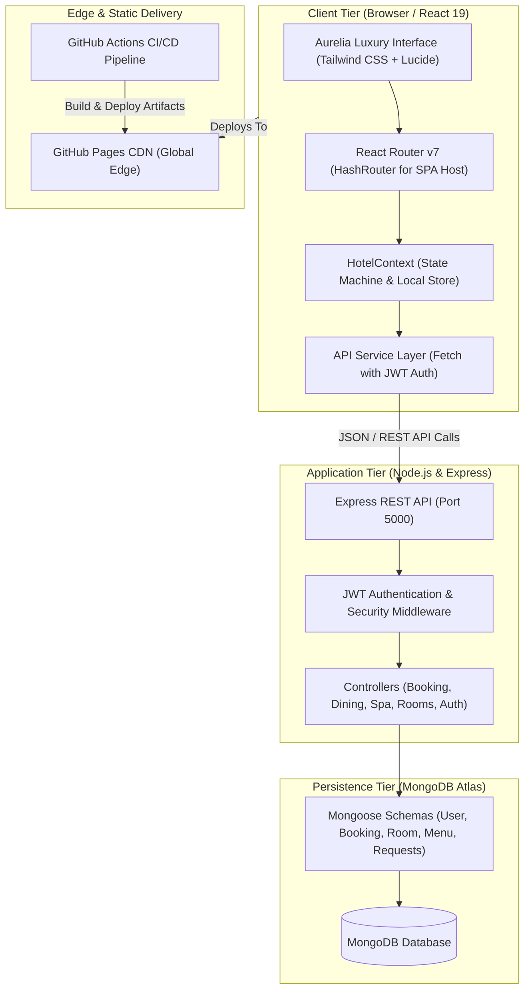

# <p align="center">✨ Aurelia Grand Resort & Spa ✨</p>
<p align="center">
  <strong>Where Mediterranean Opulence Meets Next-Generation Hospitality Engineering</strong>
</p>

<p align="center">
  <em>A 5-Star Oceanfront Resort, Luxury Suite Booking Engine & Bespoke Guest Portal</em>
</p>

<p align="center">
  <a href="https://rethmi.github.io/hotel-demo/"></a>
  <a href="https://react.dev/"></a>
  <a href="https://vitejs.dev/"></a>
  <a href="https://tailwindcss.com/"></a>
  <a href="https://nodejs.org/"></a>
  <a href="https://expressjs.com/"></a>
  <a href="https://www.mongodb.com/"></a>
  <a href="#license"></a>
</p>

---

## 🧭 Table of Contents

- [🌟 Architectural Vision](#-architectural-vision)
- [✨ Key Features & Modules](#-key-features--modules)
  - [🛎️ Multi-Step Luxury Booking Engine](#️-multi-step-luxury-booking-engine)
  - [🛏️ Suites & Penthouse Showcase](#️-suites--penthouse-showcase)
  - [🍽️ Haute Gastronomy & Table Reservations](#️-haute-gastronomy--table-reservations)
  - [🧖 Serenity Spa & Wellness Sanctuary](#-serenity-spa--wellness-sanctuary)
  - [🛎️ 24/7 Digital Concierge & Room Service](#️-247-digital-concierge--room-service)
  - [👑 Aurelia Privé Loyalty & Guest Portal](#-aurelia-privé-loyalty--guest-portal)
  - [🌍 Multi-Currency & Internationalization](#-multi-currency--internationalization)
- [🏛️ System Architecture](#️-system-architecture)
- [📂 Codebase Structure](#-codebase-structure)
- [🔌 REST API Specifications](#-rest-api-specifications)
- [🎨 Design Aesthetics & Color Palette](#-design-aesthetics--color-palette)
- [⚡ Quick Start Guide](#-quick-start-guide)
  - [Prerequisites](#prerequisites)
  - [1. Clone the Repository](#1-clone-the-repository)
  - [2. Install Dependencies](#2-install-dependencies)
  - [3. Configure Environment Variables](#3-configure-environment-variables)
  - [4. Seed Database (Optional / Backend)](#4-seed-database-optional--backend)
  - [5. Run Development Servers](#5-run-development-servers)
- [🚀 Continuous Integration & Deployment](#-continuous-integration--deployment)
- [📄 License & Acknowledgments](#-license--acknowledgments)

---

## 🌟 Architectural Vision

**Aurelia Grand Resort** is an ultra-luxury digital hospitality ecosystem crafted for high-net-worth travellers, luxury resorts, and boutique hotel brands. Designed with the precision of haute horlogerie and the fluidity of modern web technology, it unifies an editorial visual aesthetic with an enterprise-grade reservation and guest-management infrastructure.

Whether hosted as a high-performance **static Progressive Web App on GitHub Pages** or paired with its dedicated **Node.js, Express & MongoDB backend cluster**, Aurelia provides a zero-latency booking workflow, real-time currency conversion, and instant guest self-service.

```
       ✦ ──────────  A U R E L I A   G R A N D   R E S O R T  ────────── ✦
      |                                                                 |
      |   "Where Mediterranean breezes meet timeless luxury, curated    |
      |    exclusively for discerning travellers worldwide."             |
      |                                                                 |
       ✦ ────────────────────────────────────────────────────────────── ✦
```

---

## ✨ Key Features & Modules

### 🛎️ Multi-Step Luxury Booking Engine
- **Seamless 4-Stage Flow**: Search availability ➔ Select suite & customizable amenities ➔ Input guest preferences ➔ Secure checkout simulation.
- **Dynamic Pricing Engine**: Nightly calculations, adult/child occupancy rules, local tourist taxes, and automatic promo code application.
- **Exclusive Add-Ons**: Helicopter transfers from Nice Airport (NCE), chilled vintage Dom Pérignon on arrival, private sunset yacht charters, and couples spa therapies.
- **Voucher Generation**: Real-time downloadable digital confirmation with unique booking references (`AGR-XXXXX-2026`).

### 🛏️ Suites & Penthouse Showcase
- **Curated Accommodation Portfolio**: From the *Deluxe Azure Room* to the ultra-exclusive *Presidential Ocean Penthouse*.
- **Interactive Suite Inspector**: High-resolution imagery galleries, square footage metrics, floor elevation, view orientation, bed configuration, and bespoke Diptyque Paris bath amenity lists.
- **Instant Availability & Wishlist**: Real-time room inventory status and guest hearting/wishlist persistence.

### 🍽️ Haute Gastronomy & Table Reservations
- **Michelin-Caliber Dining Catalog**: Highlights signature venues like *L'Horizon Oceanfront*, *La Trattoria Riviera*, and *The Starlight Lounge*.
- **Direct Table Reservation System**: Select time slots, seating sections (Oceanfront Terrace, Wine Cellar, Chef’s Table), guest counts, and dietary requirements.

### 🧖 Serenity Spa & Wellness Sanctuary
- **Signature Treatments**: Thalassotherapy journeys, Diamond radiance facials, and volcanic stone massages.
- **Therapist & Cabana Scheduling**: Select preferred treatment duration, private cabana location, and treatment time slots.

### 🛎️ 24/7 Digital Concierge & Room Service
- **Digital In-Room Dining**: Browse gourmet breakfast baskets, Ossetra caviar, and artisanal cocktails with live cart subtotal and room-delivery scheduling.
- **Concierge Requests**: Request private yacht charters, bespoke anniversary setups, extra down pillows, or express chauffeur dispatch directly from the guest portal.

### 👑 Aurelia Privé Loyalty & Guest Portal
- **VIP Tier Recognition**: Silver, Gold, and Platinum tier trackers featuring accumulated reward points and VIP perks.
- **Reservation Self-Service**: Review upcoming and historical stays, request booking amendments, or initiate instant cancellations with clear policy terms.
- **Notification Feed**: Live inbox for reservation confirmations, concierge messages, and personalized seasonal invitations.

### 🌍 Multi-Currency & Internationalization
- **Real-Time Currency Switching**: Live exchange rate updates for **USD ($), EUR (€), GBP (£), JPY (¥), AUD (A$), and AED (د.إ)**.
- **Global Localization**: Ready for international travellers with multi-language indicators (EN, FR, DE, ES, IT, JA, AR).

---

## 🏛️ System Architecture



---

## 📂 Codebase Structure

```bash
hotel-demo/
├── .github/
│   └── workflows/
│       └── deploy.yml            # Automated CI/CD deployment to GitHub Pages
├── backend/                      # Enterprise Node.js / Express backend
│   ├── .env.example              # Template for server environment variables
│   ├── package.json              # Backend dependencies (Mongoose, Express, JWT)
│   └── src/
│       ├── config/
│       │   └── db.js             # Resilient MongoDB connection logic
│       ├── controllers/          # Business logic for auth, reservations, rooms, spa
│       ├── middleware/           # JWT auth token verify & global error handlers
│       ├── models/               # Mongoose data schemas (User, Booking, Room, etc.)
│       ├── routes/               # Modular Express API routing definitions
│       ├── scripts/
│       │   ├── seed.js           # Full database seeding script with luxury data
│       │   └── testEndpoints.js  # Automated backend API smoke test runner
│       └── server.js             # Server bootstrap & Express configuration
├── public/                       # Static assets & favicon icons
├── src/                          # Modern React 19 Client
│   ├── assets/                   # Vector logos, high-res resort branding
│   ├── components/               # Modular reusable UI atoms and luxury organisms
│   │   ├── BookingBar.jsx        # Floating luxury booking & date picker bar
│   │   ├── CookieBanner.jsx      # GDPR compliance banner
│   │   ├── Footer.jsx            # Multi-column luxury sitemap & newsletter signup
│   │   ├── GlobalSearchModal.jsx # Quick search overlay with keyboard shortcuts
│   │   ├── Motion.jsx            # Fluid transition animations
│   │   ├── Navbar.jsx            # Transparent-to-solid navigation header
│   │   ├── RoomCard.jsx          # Interactive luxury suite presentation card
│   │   ├── ScrollToTop.jsx       # Route change scroll reset utility
│   │   └── Toast.jsx             # Luxury status & notification toasts
│   ├── context/
│   │   └── HotelContext.jsx      # Global context for booking, auth, currency & cart
│   ├── data/
│   │   └── hotelData.js          # Master dataset of suites, dining, spa & amenities
│   ├── pages/                    # 30+ Dedicated application views
│   │   ├── HomePage.jsx          # Hero section, curated experiences & guest reviews
│   │   ├── BookingFlowPage.jsx   # 4-stage interactive reservation engine
│   │   ├── RoomsPage.jsx         # Complete suites catalog with granular filters
│   │   ├── DiningPage.jsx        # Fine-dining showcases & table reservation
│   │   ├── SpaPage.jsx           # Wellness sanctuary & treatment booking
│   │   ├── AccountPage.jsx       # Aurelia Privé guest portal & history
│   │   └── ...                   # Legal, FAQ, Contact, Gallery, & Auth views
│   ├── services/
│   │   └── api.js                # Frontend API client communicating with backend
│   ├── App.jsx                   # Root layout, routing and providers
│   ├── index.css                 # Custom Tailwind utilities, fonts & animations
│   └── main.jsx                  # Application entry point
├── index.html                    # HTML shell with Google Fonts (Playfair & Inter)
├── package.json                  # Root npm scripts & client dependencies
├── tailwind.config.js            # Custom luxury color palette & typography tokens
└── vite.config.js                # Vite build configuration with proxy settings
```

---

## 🔌 REST API Specifications

The included backend provides clean, predictable REST endpoints for all resort operations:

| Method | Endpoint | Description | Access |
|---|---|---|---|
| `GET` | `/api/health` | Service health status & database connectivity | Public |
| `POST` | `/api/auth/register` | Register new guest account | Public |
| `POST` | `/api/auth/login` | Authenticate existing guest and issue JWT | Public |
| `POST` | `/api/auth/demo` | Quick demo guest login (Lord Julian Davenport) | Public |
| `GET` | `/api/auth/me` | Fetch active guest profile & loyalty points | Private |
| `GET` | `/api/rooms` | Retrieve all suites with availability & filter criteria | Public |
| `GET` | `/api/rooms/:id` | Detailed suite specifications & photo gallery | Public |
| `GET` | `/api/bookings` | Fetch guest booking records | Private |
| `POST` | `/api/bookings` | Create new reservation with add-ons & dates | Public / Private |
| `PUT` | `/api/bookings/:id/cancel`| Cancel existing reservation under policy rules | Private |
| `POST` | `/api/dining/reservations` | Reserve table at resort restaurants | Public |
| `POST` | `/api/spa/appointments` | Book spa & wellness treatment session | Public |
| `POST` | `/api/room-service/orders` | Place in-room gourmet dining order | Private |
| `POST` | `/api/requests` | Submit private concierge / guest service request | Private |
| `POST` | `/api/contact` | Send general inquiry or VIP wedding request | Public |

---

## 🎨 Design Aesthetics & Color Palette

Crafted with high-fashion editorial restraint, Aurelia balances warm Mediterranean textures with opulent golden accents:

| Token | Hex Code | Visual Sample | Usage |
|---|---|---|---|
| **Gold Primary** | `#D4AF37` | `` | Primary accents, VIP badges, ratings, and call-to-actions |
| **Gold Light** | `#F3E8C8` | `` | Subtle borders, elevated badge backgrounds, hover glows |
| **Warm Sand** | `#FAF8F5` | `` | Canvas background, softening digital screen glare |
| **Deep Charcoal** | `#1A1A1A` | `` | Primary typography and luxury contrast headers |
| **Ocean Navy** | `#0B192C` | `` | Nighttime themes, footers, and modal overlays |

### Typography Hierarchy
- **Editorial Display**: `Playfair Display` & `Cormorant Garamond` (Hero headers, suite names, quote accents)
- **Interface & Data**: `Inter` (Booking metrics, dates, prices, form inputs, navigation items)

---

## ⚡ Quick Start Guide

### Prerequisites
- [Node.js](https://nodejs.org/) (version **18.x** or **20.x** recommended)
- [npm](https://www.npmjs.com/) (version **9+** or **10+**)
- Optional: [MongoDB](https://www.mongodb.com/) (Local Community Server or MongoDB Atlas cluster for full-stack mode)

---

### 1. Clone the Repository
```bash
git clone https://github.com/Rethmi/hotel-demo.git
cd hotel-demo
```

### 2. Install Dependencies
Install client and root development dependencies:
```bash
npm install
```

*(Optional)* If running the backend service locally:
```bash
cd backend
npm install
cd ..
```

### 3. Configure Environment Variables
Copy the template in the `backend/` directory:
```bash
cp backend/.env.example backend/.env
```
Customize `backend/.env` with your preferred settings:
```env
PORT=5000
NODE_ENV=development
MONGO_URI=mongodb://127.0.0.1:27017/aurelia_hotel
JWT_SECRET=your_super_secret_jwt_key_here
JWT_EXPIRES_IN=30d
CLIENT_URL=http://localhost:3000
```

### 4. Seed Database (Optional / Backend)
Populate your MongoDB database with realistic suites, restaurants, reviews, and test user accounts:
```bash
npm run server:seed
```

### 5. Run Development Servers

#### Option A: Frontend Showcase Mode (Client-only with built-in mock state)
```bash
npm run dev
```
Open **[http://localhost:3000](http://localhost:3000)** in your browser.

#### Option B: Full-Stack Mode (Frontend + Express API Server)
In terminal 1 (Start the Backend API):
```bash
npm run server:dev
```
In terminal 2 (Start the React Frontend):
```bash
npm run dev
```
The Vite development server will automatically proxy `/api` requests to `http://localhost:5000`.

---

## 🚀 Continuous Integration & Deployment

The repository includes a ready-to-run GitHub Actions workflow (`.github/workflows/deploy.yml`):

1. **Push to `main`** triggers an automated production build (`npm run build`).
2. SPA client-routing fallback is ensured via automated copying of `dist/index.html` to `dist/404.html`.
3. The production bundle is deployed instantly to the `gh-pages` branch.
4. **Live URL**: **[https://rethmi.github.io/hotel-demo/](https://rethmi.github.io/hotel-demo/)**

---

## 📄 License & Acknowledgments

This project is licensed under the **MIT License** — you are free to customize, adapt, and deploy it for commercial and private hospitality projects.

### Curated Craftsmanship
- Imagery sourced via [Unsplash](https://unsplash.com) under the Unsplash License.
- Iconography by [Lucide Icons](https://lucide.dev/).
- Fonts served via [Google Fonts](https://fonts.google.com/).

<p align="center">
  <sub>Designed & Developed with passion for the art of luxury hospitality.</sub>
  <br />
  <strong>© 2026 Aurelia Grand Resort. All rights reserved.</strong>
</p>
